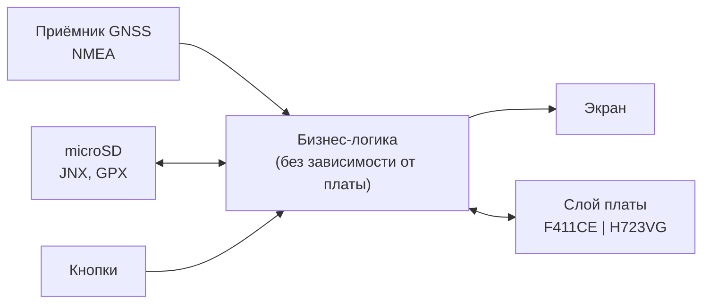

# Спутник

Прототип наручного навигатора с небольшим экраном: запись трека в GPX, отображение трека на
растровой карте JNX (Garmin BirdsEye), навигация по GPS/ГЛОНАСС, анализ трека во время записи
и после сохранения.

Состояние: этап 1 — структура репозитория и первая ревизия
[технического задания](docs/TECHNICAL_SPECIFICATION.md). Кода и проектов CubeMX пока нет.



## Платы

| Профиль | Плата | MCU | Flash / RAM |
| :--- | :--- | :--- | :---: |
| `F411CE` | [WeAct BlackPill](https://github.com/WeActStudio/WeActStudio.MiniSTM32F4x1) V3.1 | STM32F411CEU6 | 512 / 128 КиБ |
| `H723VG` | [WeAct STM32H723 Core Board](https://github.com/WeActStudio/WeActStudio.MiniSTM32H723) | STM32H723VGT6 | 1024 / 564 КиБ |

Функции, которые не помещаются в ресурсы F411 (поворот карты по курсу, кадровый буфер, кэш
тайлов, длинные маршруты), доступны только на H723 — таблица в п. 3.3 ТЗ. Экран, приёмник GNSS,
накопитель, кнопки и питание ещё не выбраны: варианты — в приложении C ТЗ, решения — открытые
вопросы 13.2.1–13.2.5.

## Получение

```sh
git clone --recursive https://github.com/ViacheslavMezentsev/sputnik.git
cd sputnik
git submodule update --init      # если клонировали без --recursive
```

Сборки пока нет: она появится вместе с проектами CubeMX. Планируется CMake с
[stm32-cmake](https://github.com/ObKo/stm32-cmake) и
[stm32-cmake-yml](https://github.com/ViacheslavMezentsev/stm32-cmake-yml), профиль платы
выбирается пресетом (`STM32_YML_PROFILE`).

## Структура

```text
boards/         профили плат для stm32-cmake-yml (TOML); позже — проекты CubeMX и слой платы
docs/           техническое задание
modules/        git-подмодули: stm32-cmake, stm32-cmake-yml, stm32-gdbtest
skills/         копии навыков агентов из demo-stm32-skills (не правятся здесь)
```

Планируется: `src/` — бизнес-логика, `hil/` — DDTT-сценарии для плат, `tests/` — тесты на ПК
и маленькие тестовые файлы, `ci/` — проверки.

| Подмодуль | Версия | Коммит |
| :--- | :--- | :--- |
| [stm32-cmake](https://github.com/ObKo/stm32-cmake) | v2.1.0+ | `ecc5acc` (закреплён в CI stm32-cmake-yml 0.10.2) |
| [stm32-cmake-yml](https://github.com/ViacheslavMezentsev/stm32-cmake-yml) | 0.10.2 | `3333d0b` |
| [stm32-gdbtest](https://github.com/ViacheslavMezentsev/stm32-gdbtest) | 0.6.1 | `7f4f2ef` |

## Формат JNX

Чтение JNX пишется по описанию формата
([рус.](https://web.archive.org/web/20220929144544/http://whiter.brinkster.net/JNX.shtml),
[англ.](https://web.archive.org/web/20151023153145/http://whiter.brinkster.net/en/JNX.shtml)).
Исходники [GPXSee](https://github.com/tumic0/GPXSee) (GPL-3.0) используются только для понимания
формата; код из них не копируется. Подробности — раздел 5 и приложение E ТЗ.

## Документы

- [Техническое задание](docs/TECHNICAL_SPECIFICATION.md)
- [TODO](TODO.md) — текущее состояние и ближайшие шаги
- [CHANGELOG](CHANGELOG.md) — изменения
- [AGENTS](AGENTS.md) — правила для участников и агентов
- [HOWTO](HOWTO.md) — команды Git и частые проблемы
- [Навыки агентов](skills/README.md)

## Лицензия

MIT ([LICENSE](LICENSE)). Подмодули и копии навыков — со своими лицензиями (MIT у модулей автора
и навыков; stm32-cmake — MIT).
