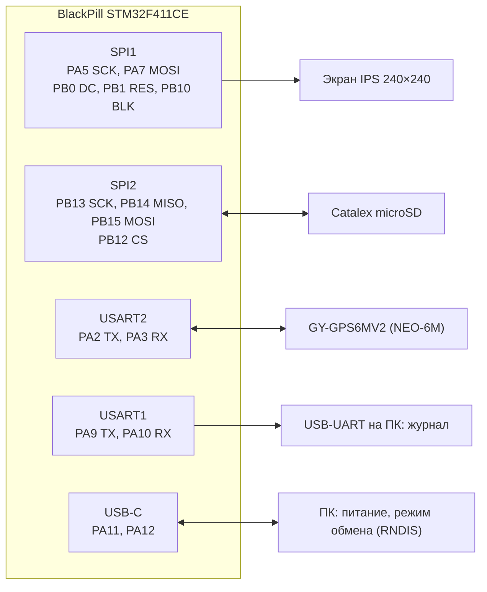

# Подключение модулей отладочного стенда

Практическая памятка к ТЗ: какой провод куда. Нормативные таблицы выводов и DMA — п. 3.6
[технического задания](TECHNICAL_SPECIFICATION.md); при расхождении верно ТЗ. Выбор модулей —
п. 3.5 ТЗ. Подключение ещё не проверялось на стенде: после первой проверки здесь появятся
отметки о результатах.

## F411CE (WeAct BlackPill V3.1)

### Экран IPS 240×240 (SPI1, отдельная шина)

| Вывод модуля | Вывод платы | Назначение |
| :--- | :--- | :--- |
| GND | GND | |
| VCC | 3V3 | питание |
| SCL | PA5 | SPI1_SCK |
| SDA | PA7 | SPI1_MOSI |
| RES | PB1 | сброс экрана |
| DC | PB0 | команда / данные |
| BLK | PB10 | подсветка, TIM2_CH3 (ШИМ) |

У модуля нет вывода CS: на шине SPI1 других устройств быть не должно. Режим SPI 3
(CPOL = 1, CPHA = 1). Провода — как можно короче: начальная частота 24 Мбит/с, цель 48 Мбит/с
(подбирается замером, ТЗ п. 8.2.8). PA6 (MISO SPI1) не подключается.

### Catalex MicroSD Card Adapter (SPI2, отдельная шина)

| Вывод модуля | Вывод платы | Назначение |
| :--- | :--- | :--- |
| GND | GND | |
| VCC | **5V** | питание от USB; при 3,3 В стабилизатор модуля не даёт нужного напряжения |
| CS | PB12 | выбор карты, программно |
| SCK | PB13 | SPI2_SCK |
| MOSI | PB15 | SPI2_MOSI |
| MISO | PB14 | SPI2_MISO |

Буфер модуля, по распространённым описаниям, не отпускает MISO при высоком CS, поэтому шина
SPI2 только для карты. Это проверяется логическим анализатором (ТЗ, TC-53).

### Приёмник GY-GPS6MV2 (USART2)

| Вывод модуля | Вывод платы | Назначение |
| :--- | :--- | :--- |
| GND | GND | |
| VCC | 3V3 или 5V | у модуля свой стабилизатор |
| RX | PA2 | USART2_TX платы → приёмник |
| TX | PA3 | USART2_RX платы ← приёмник |

9600 бит/с, 8N1, NMEA 1 Гц. NEO-6M принимает только GPS (без ГЛОНАСС). Антенну — к окну или
наружу: в помещении решения может не быть.

### Прочее

| Узел | Вывод | Примечание |
| :--- | :--- | :--- |
| Журнал | PA9 TX, PA10 RX | USB-UART 3,3 В на ПК, 115 200 бит/с |
| Кнопка KEY | PA0 | на плате |
| Светодиод | PC13 | на плате, горит при 0 |
| SWD | PA13, PA14, GND, 3V3 | ST-Link |
| USB-C | PA11, PA12 | питание и режим обмена |

## H723VG (WeAct STM32H723 Core Board)

Экран 0,96" ST7735 (SPI4: PE12, PE14, CS PE11, DC PE13, подсветка PE10), слот microSD
(SDMMC1: PC8–PC12, PD2), кнопка K1 (PC13) и светодиод (PE3) — на плате, проводов не нужно.
Экран устанавливается по инструкции WeAct (сгиб шлейфа, двусторонний скотч).

| Подключение | Вывод модуля | Вывод платы |
| :--- | :--- | :--- |
| Приёмник GY-GPS6MV2 | GND / VCC / RX / TX | GND / 3V3 / PA2 / PA3 |
| Журнал (USB-UART) | RX / TX | PA9 / PA10 |
| SWD | SWDIO / SWCLK | PA13 / PA14 |

Не используются на этапе: SPI Flash (SPI1), OSPI Flash, разъём камеры DCMI.
